# Описание лабораторной работы №3 
!!! дописать в конце !!!

# Шаг 0 - Сервисы
Сгенерировал api и worker. Интересно выглядят, не примитивно, надо будет потом разобраться, что там вообще написано :)

Проверил, что все работает и поднимается с помощью временного docker-compose.

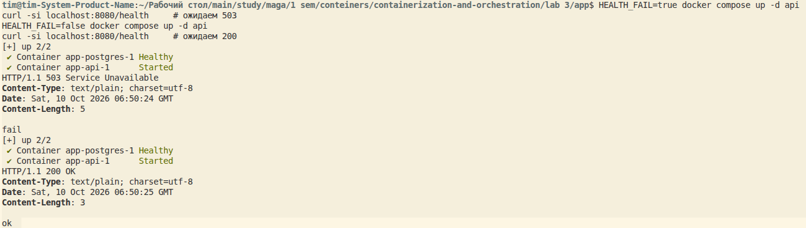

# Шаг 1 - Защита на кластер
Выбрал Kyverno, потому что yaml знаю и понимаю, а про Rego слышу впервые. Помимо этого Kyverno легко устанавливается. Единственным плюсом OPA / Gatekeeper нашел производительность за счет того, что Rego компилируемый язык, но как-то меня это не впечатлило на фоне сложности в том, чтобы разобраться в нем. 

Выбрал 5 правил для кластера:
- Обязательные лимиты и запросы ресурсов. Нужен, чтобы каждый контейнер в Pod имел свой requests и limit. Если правила нет, то один может съесть всю память сам. И вместо того, чтобы упал и перезапустился один под, упадет весь сервис. 
- Доверенный реестр образов. Правило ограничивает источники образов известными и контролируемыми.  
- Обязательные метки. С ними проще взаимодействовать с Pod'ами. Метки позволяют проще фильтровать объекты, строить NetworkPolicy, собирать метрики по приложению. 
- Запрет :latest. Тег latest - тег, который легко изменяется и строить на нем какую-то логику может быть небезопасно. 
- Readiness / liveness пробы обязательны. Пробы нужны для проверки работоспособности приложения.

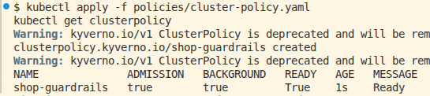

запустил 5 манифестов, все 5 выдали по одной ошибке. Ниодного пода не создалось. После прогона `kubectl get pods -A | grep -E 'no-resources|no-labels|no-probes|untrusted-registry|latest-tag'` возвращает пустоту, значит не один из манифестов не попал в etcd. 
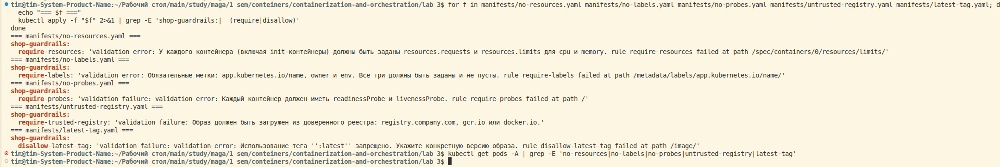

Добавил в cluster-policy.yaml exclude, потому что Helm-чарты, которые мне нужны, не удовлетворяют моим правилам :) Без exclude установка чартов невозможна, но теперь системные неймспейсы выведены из под действия правила. На практике бы пришлось писать более мягкие правила для каждого неймспейса. 

Между днями работы над лабой, решил, что надо установить обновление на убунту. В следующий раз заходя в систему, вижу, что разрешение монитора практически превратилось в тыкву, Потратил около часа, чтобы решить эту проблему, оказалось, что слетели драйвера для видеокарты. Было больно, особенно глазам... 

# Шаг 2 - чарт api и worker
Запушил оба образа api и worker на локальный реестр на localhost:5001
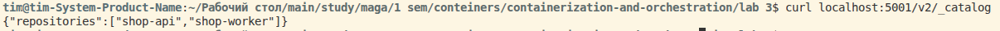

Написал Chart.yaml, values.yaml и шаблоны Deployment/Service для api и worker. Также в шаблонах написал StatefulSet + headless Service для PostgreSQL, так как PostgreSQL нужен для поднятия api. Все добавленные объекты удовлетворяют правилам, написанным в 1 части. 

При первой попытке столкнулся с проблемой, что api имеет количество restarts равное 6, у worker и postgres - 0. Причина оказалась в том, что api/main.go сначала идет конект с db, а только потом запускается сервер, а livenessProbe начинал стучаться в /health раньше, чем сервер успевал подняться. Было принято решение добавить startupProde, чтобы пока sturtup не поднялся, то и liveness не проверяется. Теперь при старте количество рестаров 0. 

Установил чарт
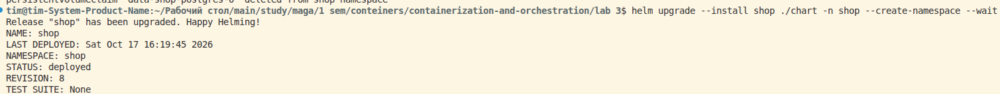

Все поды в статусе running и в нужном количестве : 3 api, 2 worker и 1 postgres
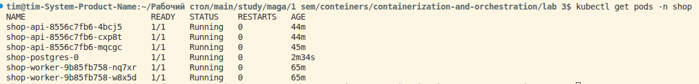

Все правила удовлетворены
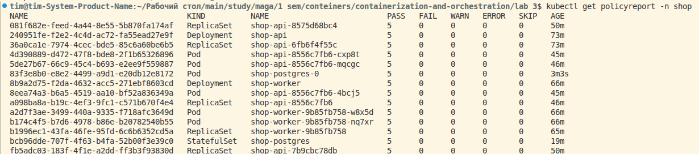

Полный цикл работы, все отработало, как надо.
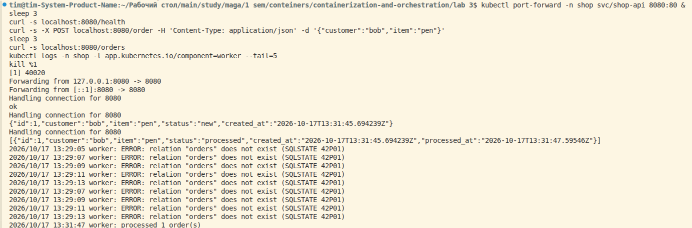

Удаляю один под api, остальные два на месте, + создается новый под api, который скоро запускается
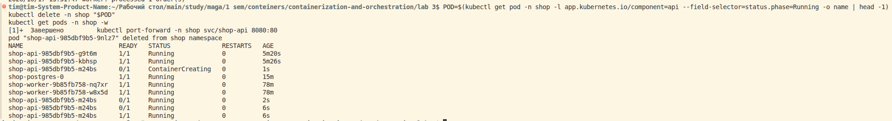

Поменял количество реплик для api. Сделал helm upgrade. Количество подов с api стало 5
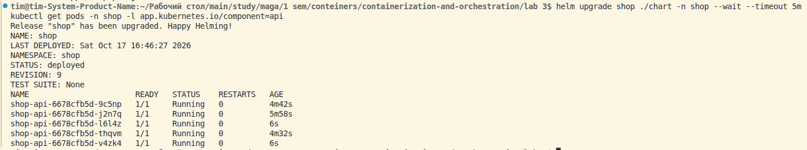

Вернул количество реплик 3, количество запущенных подов подстроилось под количество реплик
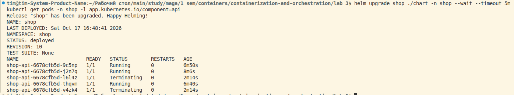

Изменил тег api, сделал helm upgrade и параллельно стучался в /health в цикле. На скриншоте видно, что сначала создались 3 пода api, затем создался еще один под api, последний запускается, после чего, один из начальных подов ложиться. 
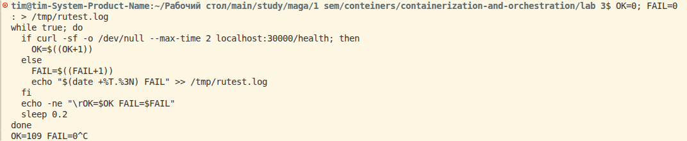
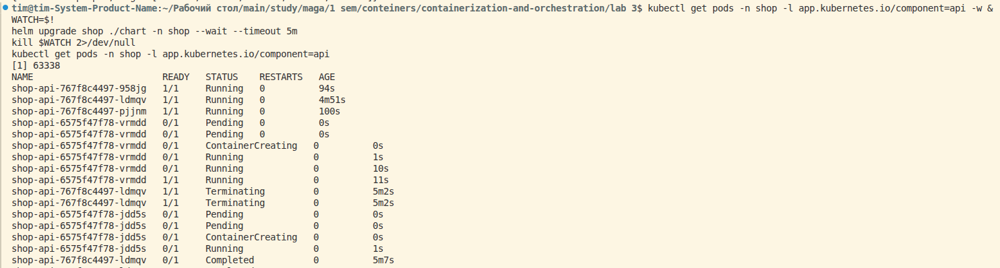

Попробовал запустить helm upgrade до и после изменения env в values.yaml
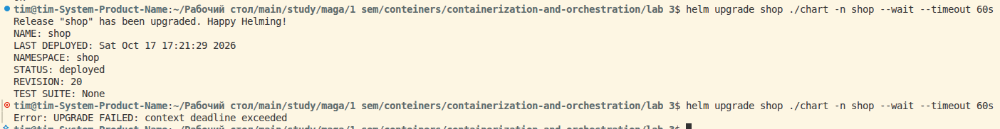

Новые поды не проходят readiness, а старые продолжают работать 
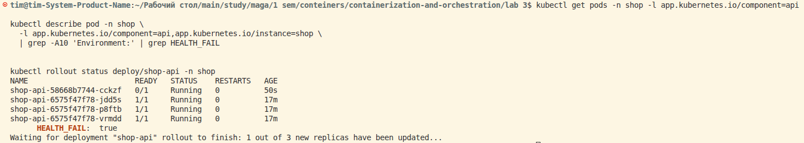
а сервер продолжает отвечать 
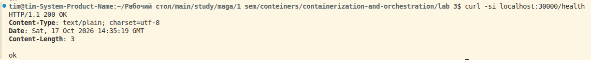

Rollback прошел успешно!!!!!!!
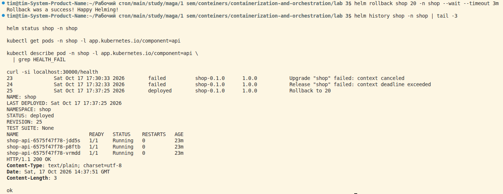

# Шаг 3 - Postgres через оператора
У меня уже поднималя постгрес, но не через оператор. Удалил все, что связано с постгресом и установил CNPG. Обновил политику кластера, чтобы он не возприменляся к cnpg-system.

Проверил, что все поды запускаются 
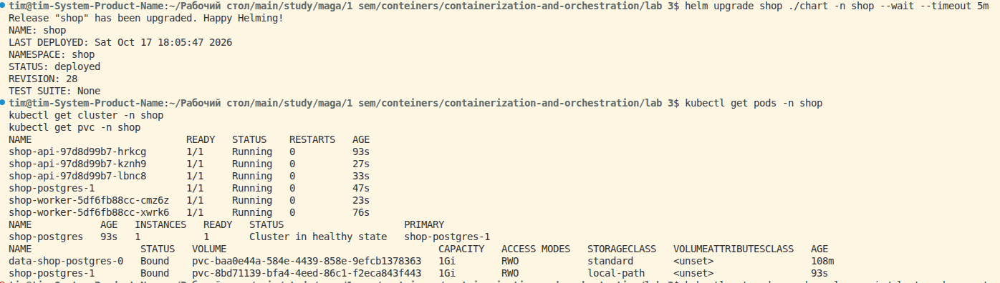

Удалил под руками, оператор его вернул
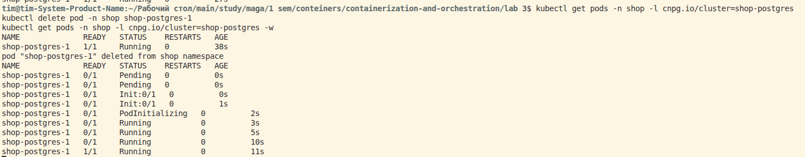

spec: 
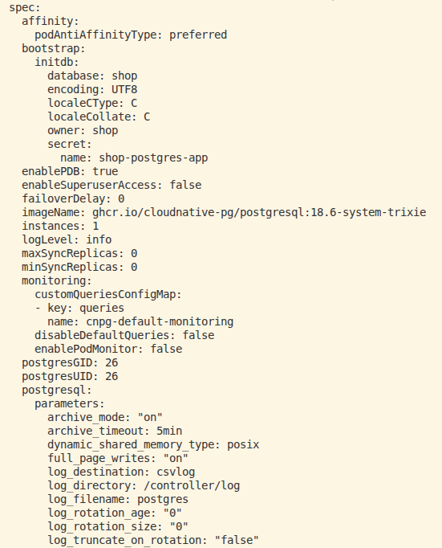

status:
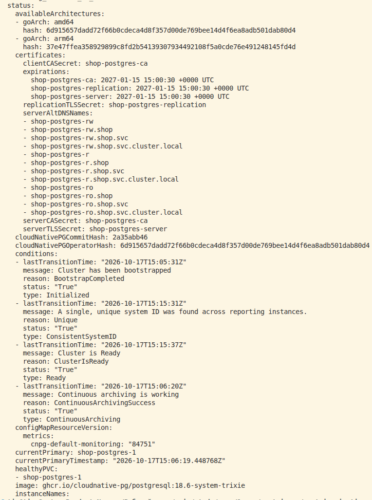

api и worker подключились с корректно
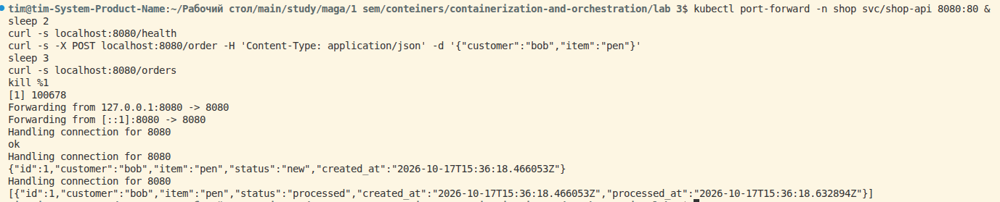

controller-manager - процесс, который крутит универсальные reconcile-loop. То есть ему все равно, что в него положили, он может оценивать только приложение на уровне кубернетиса, к примеру, считать количество подов и их готовность. А оператор работает с конкретной разновидностью приложения. В случае с postgres оператор не только будет пересоздавать под, но и сможет, к примеру, определить какой из подов является primary.

# Шаг 4 - Падение control plane
Остановка etcd
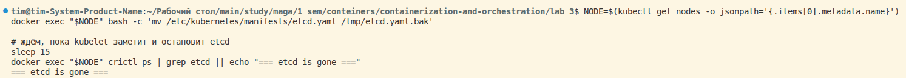

Кластер неуправляемый
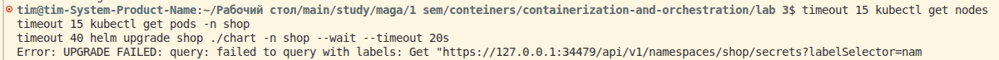

Но сервис работает
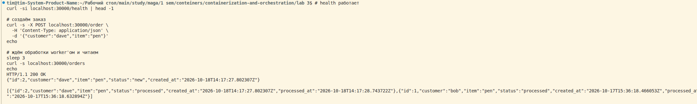

Ноль ошибок
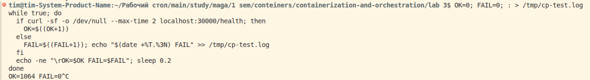

Возвращаю работающий control plane
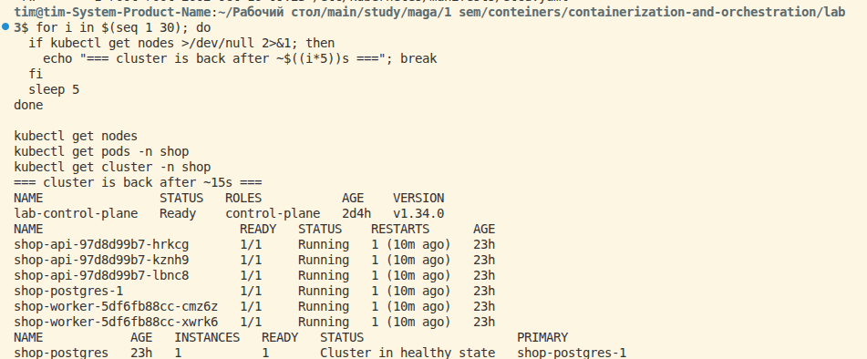

Все полностью восстановилось

