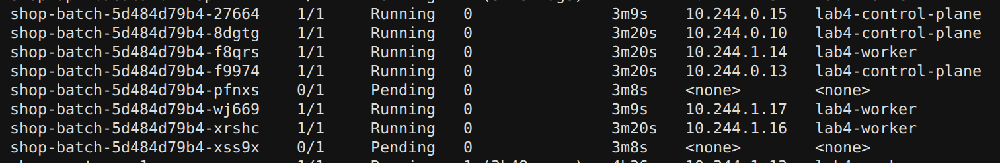
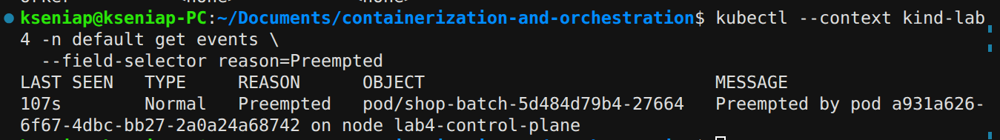
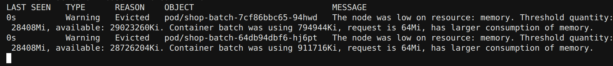
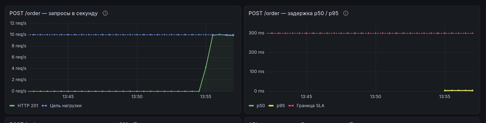
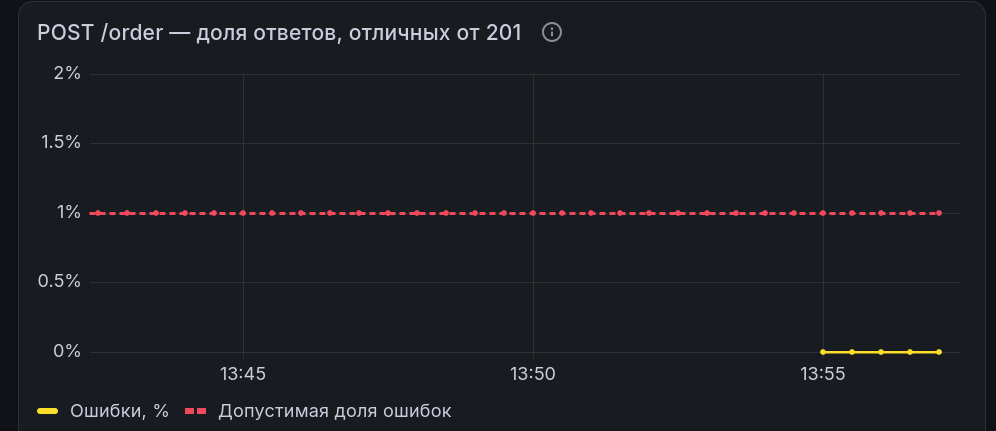
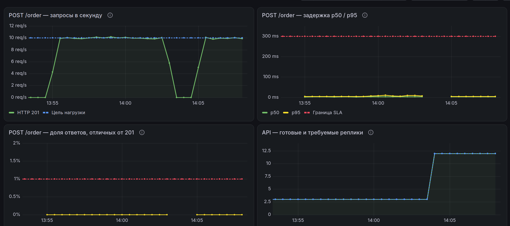
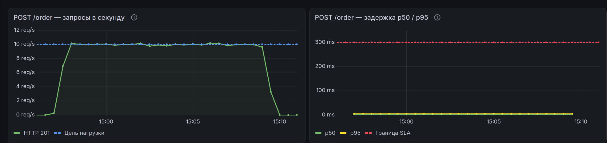
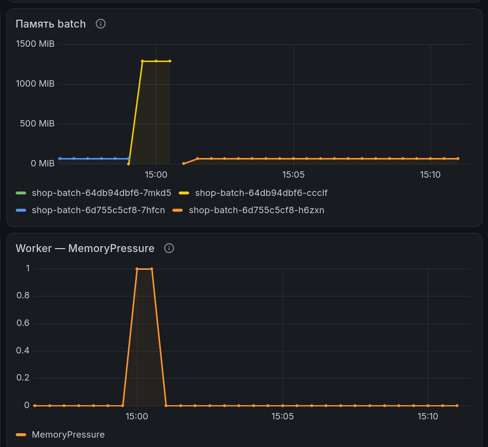
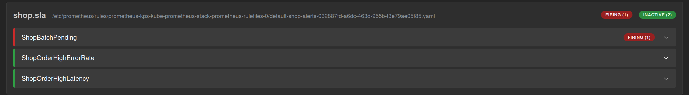

# Описание лабы


Интересный факт: слово Господи было произнесено мной за эту лабу больше раз, чем все слова Поды, Ноды,
Шедулер и CPU вместе взятые.

## Часть 0

Написала небольшую программу на го. Все что она делает - занимает место в памяти (по умолчанию 64 Мб), и
занимает примерно 50% CPU

**Проверка:**

```bash
docker run -d --rm --name lab4-batch \
  --cpus=0.5 \
  --memory=256m \
  -e MEMORY_MIB=64 \
  localhost:5001/shop-batch:1.0.0
```


## Часть 1: Два стула

Итак, есть два стула, на одном `podAntiAffinity`, а на другом `topologySpreadConstraints`.

`podAntiAffinity` такой злой чел, негативный, соседей не любит: если у нас две реплики на двух нодах, то
третью реплику он никуда не пустит, и она останется висеть в состоянии `pending`. Но в мягком режиме ему
можно сказать "эээ братишка пусти переночевать" - в таком случае планировщик старается разнести поды, но
может разместить их и вместе

`topologySpreadConstraints` ровный пацанчик - старается поддерживать равномерность распределения подов.
За базар отвечает, если сказано перекос между зонами не больше одного пода, значит все по красоте сделает -
две реплики на одной ноде, одна на другой.

В качестве основного механизма решила выбрать `topologySpreadConstraints`, чтобы равномерно распределять
поды. Файл [values.yaml](chart/values.yaml) взят полностью из 3 лабы.

теперь в нем добавилось поле `placement`

```yaml
api:
  replicas: 3
  placement:
    mode: topologySpreadConstraints
    topologySpreadConstraints:
      maxSkew: 1
      topologyKey: kubernetes.io/hostname
      whenUnsatisfiable: DoNotSchedule
      labelSelector:
        matchLabels:
          app.kubernetes.io/component: api
```

тут `maxSkew` - допустимая разница между нодами в количестве подов,

`topologyKey`: `kubernetes.io/hostname` - распределение между нодами,

`whenUnsatisfiable: DoNotSchedule` — под ждёт, если размещение нарушит правило,

`labelSelector` учитывает поды `api`

Можно было бы использовать и `podAntiAffinity` с мягким режимом, но я побоялась что если при
необходимости он может распределять поды 2 к 1, то не исключена ситуация, что он разместит все 3 реплики
на одной ноде, а такого нам не хотелось бы

На всякий случай проверяю что чарт собирается без ошибок:

```bash
helm lint "lab 4/chart"
```

**результат:**

```text
1 chart(s) linted, 0 chart(s) failed
```

## Часть 2: В тесноте и в обиде

Создам кластер с одной работающей нодой и одной управляющей. (см [kind-config.yaml](kind-config.yaml))

```bash
kind create cluster \
  --name lab4 \
  --config "lab 4/kind-config.yaml" \
  --wait 3m
```

(забавно что с первого раза ничего естественно не запустилось и ломалось на последнем этапе:

```text
 ✗ Joining worker nodes 🚜
Deleted nodes: ["lab4-worker" "lab4-control-plane"]
ERROR: failed to create cluster: failed to join node with kubeadm: command "docker exec --privilegedlab4-worker kubeadm join --config /kind/kubeadm.conf --v=6" failed with error: exit status 1
```

после того как я сделала буквально НИЧЕГО и попробовала еще раз, все заработало

Ну что за магия )

Проверяем как там наши ноды:


Ноды замечательно, а значит установлю оператор CloudNativePG, и добавлю его в наш кластер, потому что он
же использовался и в 3 лабе.

```bash
helm repo add cnpg https://cloudnative-pg.github.io/charts
helm repo update cnpg

helm upgrade --install cnpg cnpg/cloudnative-pg \
  --kube-context kind-lab4 \
  --namespace cnpg-system \
  --create-namespace \
  --wait \
  --timeout 5m
```

После этого скачала Kyverno и настроила гвардрейлы, чтобы синхронизироваться с 3 лабой

(хаха гвардрейлы такое смешное слово, я читаю его каждый раз как Гвардиола, что говорит о том, что мне
стоило меньше смотреть футбол этим летом)

Ладно, хиханьки да хаханьки закончились, поэтому собираю бразы `api` и `worker`, а затем загружаю их
вместе с `batch` в кластер.

```bash
docker build \
  -f "lab 3/app/api.Dockerfile" \
  -t localhost:5001/shop-api:1.0.4 \
  "lab 3/app"

docker build \
  -f "lab 3/app/worker.Dockerfile" \
  -t localhost:5001/shop-worker:1.0.0 \
  "lab 3/app"

kind load docker-image \
  localhost:5001/shop-api:1.0.4 \
  localhost:5001/shop-worker:1.0.0 \
  localhost:5001/shop-batch:1.0.0 \
  --name lab4
```

В консоли после этого мне выводилось очень много букв, но как правило они означали успешный успех

После этого я добавила `batch` в Helm-чарт (см. [values.yaml](chart/values.yaml) и
[templates/batch-deployment.yaml](chart/templates/batch-deployment.yaml)) и запустила чарт:

```bash
helm upgrade --install shop "lab 4/chart" \
  --kube-context kind-lab4 \
  --namespace default \
  --wait \
  --timeout 10m
```

Проверяю поды приложения shop - с ними все хорошо


Главный вопрос - а для чего нужны были все эти телодвижения?

А сейчас мы с вами это и узнаем.

## Часть 3: Реальные пацаны

Суть всего этого замута, если я правильно поняла, в том что `batch` жрет ресурсы, обделяя своих
товарищей. А мы такое терпеть не собираемся, а потом считаем циферки и понимаем сколько CPU и памяти
действительно нужно магазину. И после насторойки кубера при нагрузке и нехватке ресурсов, первым ими
жертвует именно `batch`, а не наш магазин.

Ну, погнали исполнять.

Первым делом подключаю мониторинг и скачиваю к6 (очередной непонятный покемон) - его просто подключаю в
терминале, а потом имитирую действия клиента в js файле

**тестовый прогон**


Но настоящий запрос лежит в файле [k6-order.js](k6-order.js). K6 же крут, потому что многократно
повторяет запросы, описанные в js файле, показывает количество запросов, задержки и ошибки. В моем файле
описаны Здесь два виртуальных клиента: каждый создаёт заказ, получает ответ и ждёт 0.2 секунды. Получится
поток примерно до 10 заказов в секунду, продолжающийся пять минут. Звучит ужасно, посмотрим как взвоет
мой сервис после такого.

Отдельно стоит отметить красоту терминала


Итог работы - все работает, сервису ок


Заодно в Prometeus посмотрела как увеличивается CPU во время процесса (`batch` я исключила из
рассмотрения, потому что там нагрузка постоянная)


После нагрузки использую `krr` для определения максимальных параметров. CPU он считает как 95 перцентиль,
память как максимум + 15%, а `10m` и `100Mi` — стандартные минимальные значения алгоритма.


Вижу что реквесты CPU и память я задала сильно больше чем нужно. Лимиты CPU `krr` требует убрать, но как
бы нононо мистер фиш, ю вонт ремув эти лимиты, наши гвардрейлы требуют их сохранить.

Оценку ресурсов для PostgreSQL я получала напрямую из Prometheus, получилось

```text
CPU	15.773801
Память	184.040429
```

Это можно округлить до `16m` и `185Mi`

Осталось только задать эти значения в [values.yaml](chart/values.yaml) и обновить через `helm upgrade`

## Часть 4: Полный разнос

Первое что я сделала на этом шаге - добавила выбор между `topologySpreadConstraints` и `podAntiAffinity`,
потому что оказывается он должен был быть еще на первом шаге... После чего в
[api-deployment.yaml](chart/templates/api-deployment.yaml) добавился такой кусок


По умолчанию все равно стоит `topologySpreadConstraints`. После `helm upgrade` смотрю новое размещение
`api`


По сути ничего не изменилось - у нас и раньше ноды были размещены 2 + 1, просто сейчас мы закрепили это
правило размещения в `Deployment`. Теперь мы точно уверены, что если одна нода упадет, то умрут не все
реплики `api`.

## Часть 5: Вiйди отсюда розбiйник

Теперь будем расставлять **PriorityClass** для подов, чтобы шедулер понимал кто здесь батя, и кому
достанется роскошная хата, а кому место у параши.

Api и `postgres` достается высокий приоритет, а `batch` - низкий. Теперь шедулер первым выселит с ноды
поды с низким приоритетом, если понадобится разместить там поды с высоким.

Итак, в [values.yaml](chart/values.yaml) завожу два класса и создаю шаблон
[PriorityClass](chart/templates/priorityclasses.yaml).


После `helm upgrade` смотрю на приоритеты подов - тут все как я и хотела.


**PDB — PodDisruptionBudget**, правило, которое задаёт, сколько подов приложения должно оставаться
доступными, например при обсуживании типа `drain`. Условно мы можем попросить на выход только один под, а
остальные должны работать.

В моем случае я настроила шаблон [api-pdb.yaml](chart/templates/api-pdb.yaml) и прописала в
[values.yaml](chart/values.yaml), что минимум который должен работать - 2 пода `api`

```yaml
pdb:
  enabled: true
  minAvailable: 2
```

Для PostgreSQL Pdb настраивается отдельно, так как этот единственный под снимать нельзя.


**QoS (Quality of Service)** — это класс, который Kubernetes автоматически присваивает поду по его
`requests` и `limits`. Класс **Guaranteed** получается, когда `requests` равны `limits` и по CPU, и по
памяти у всех контейнеров пода. **Burstable** это когда ресурсы заданы, но не равны, и еще есть
**BestEffort**, когда вообще ничего не задано, и его кикают первым.

Я хочу получить **Guaranteed** для `api` и `postgres`, а значит надо задать лимиты равными реквестам, то
есть по `10m` у апи и `16m` у базы.


О, как же я ошибалась! Как же я ничего не понимала, страдала и плакала когда `helm upgrade` выдавал мне
ошибку! Я очень долго с этим разбиралась, очень, за это время успели вырасти деревья, отстроиться города,
а однокласники выйти замуж и родить детей... Как выяснилось, `10m` это очень мало для жесткого лимита,
из-за чего я все время ловила таймауты.

Но даже так, в моем мозгу произошел коллапс - как же так, надо ставить разные реквесты и лимиты, чтобы
следовать рекомендациям `krr` и при этом не ломаться, но при этом одинаковые, чтобы получить
**Guaranteed**. Кто-нибудь помогите мне решить эту великую загадку человечества...

В общем видимо **Guaranteed** мне важнее чем рекомендации `krr`, поэтому для `api` и PostgreSQL я
поставила CPU `200m` везде. Получила свои заветные **Guaranteed** и геморой в жопе.


## Часть 6: Автобус

Наплодила 8 реплик `batch`, у каждой CPU теперь 2 ядра, а лимит - 3 ядра. Предполагается что на каждую
ноду поедет по 3 реплики, и еще 2 останутся `Pending`.



Шедулер пишет следующее

```text
Warning  FailedScheduling  111s (x9 over 12m)  default-scheduler  0/2 nodes are available: 2 Insufficient cpu. preemption: 0/2 nodes are available: 2 No preemption victims found for incoming pod.
```

Стоит отметить, что расчет ведется по `requests` подов, а не по абсолютным лимитам. И отказ в размещении
означает, что свободного места на ноде меньше чем `request` пода.

Тут можно представить что нода это автобус в час пик. Ну тянет меня на философию в 2 часа ночи, что
поделать. Вместимость нашего автобуса - 8 ядер. А бедолаг, едущих в студию в Мурино, больше, чем 8 ядер,
поэтому они придумали хитрость - бронировать для себя места, а ля `requests`. Но то ли сбой в системе, то
ли еще что - последнее место забронировали одновременно скандальная бабка (`api` и `postgres`) и школьник
(`batch`).

И контролер смотрит на это дело и понимает, что с бабкой ругаться ему совсем не хочется, так как у нее
`PriorityClass` `1000`, а отказать в посадке ребенку с приоритетом `-10` - плевое дело. Так `batch` и
остаются в `Pending`.

А теперь давайте представим, что автобус укомплектован, готов ехать, но тут в нему подбегает целая толпа
бабок, и орут мол, мы вообще то занимали! Страшно, очень страшно, контролер понимает что они и заяву на
него могут накатать, если он их в автобус не пустит. Что же делать? В таком случае единственный выход -
это вышвырнуть (`preemption`) какого нибудь сопливоого школьника (осуждаю) и освободить тем самым место.

Чтобы сымитировать эту ситуацию, я сделала 12 реплик `api`, которые в сумме теперь будут просить `2400m`
CPU. А свободно по `requests` на двух нодах осталось всего `1730m`. а это значит что шедулер будет
вытеснять `batch` с низким приоритетом.



Планировщик удалил `batch` …27664, чтобы разместить API. Deployment `batch` сразу создал ему замену, но
ей места уже не хватило, поэтому она осталась `Pending`.

Интересно, что если не знать про вытеснение, это оследить непросто, так как вытесненный под исчезает, и
все что я вижу когда смотрю список подов - что какие то `Running`, а какие-то `Pending`.

## Часть 7: Маршрутка

Теперь пусть у нас будет не элитный автобус с возможностью бронировать места, а обычная маршрутка. И
пусть в него ломятся школьники с огромными рюкзаками и бабки с тележками. Марштурка может вместить
определенное число пасажиров - `available memory`, но водитель Ашот хочет оставить некоторое место
(`memory eviction threshold`), чтобы привезти братишкам насвай. Если пасажиров так много, что некуда
становится положить насвай, то приходится кого-нибудь выгонять - первыми под удар попадают школьники, как
мы уже выяснили.

Для этого я вернула настройки как было - теперь у нас снова 3 `api` и 1 `batch`, но поставила
`memory limit` у `batch` `1Gi` и фактическое потребление памяти `MEMORY_MIB` `768Mi`. Буфер занимает
память, но при этом собственный лимит `batch` по памяти `1Gi`, чтобы конейнер не был убит раньше по
своему лимиту. При этом порог памяти ноды `28408Mi`, который я поставила с помощью скрипта
[memory-pressure.py](memory-pressure.py)



Тут два пода `batch` выселили, потому что их потербение было примерно `776Mi` и `890Mi` (для второго я
подняла `MEMORY_MIB` и `memory limit`), и `available memory` опускался ниже порога. Так как они оба
`Burstable` с низким приоритетом и потребляют больше чем `request`, то жествами стали именно они.

Если бы я поставила `memory limit`, например, `700Mi`, то произошел бы уже `OOMKilled`, так как под
занимал бы больше места чем ему дозволено.

## Часть 8

Здесь я немного устала, и не смогла придумать смешное название заголовку, да и впринципе шутки у меня
кончились...

**SLA пусть будет такой:**

При нагрузке 10 заказов в секунду не менее 99% запросов `POST /order` завершаются успешно, а 95% запросов
завершаются быстрее 300 мс

Для k6 написала новый сценарий в скрипте [k6-sla.js](k6-sla.js)

Запустила скрипт в обычном режиме - 10 заказов в секунду - так он поработал минуты 2, потом я добавила
нехватку





Потом я повторила действия 6 шага - 6 подов `batch`, 12 подов апи, вытеснение.



Тут видно на нижнем графике что реплик `api` 12 штук, значит процесс пошел. Ошибок нет, SLA выполняется
(место где график обрывается - это просто у меня закончилось время работы скрипта, заказы перестали
приходить, и я его заново запустила)

После этого я повторила действия из 7 задания





На втором скрине видно как один из подов `batch` начинает занимать много памяти, после чего выселяется и
график обрывается. Ошибок по прежнему нет

## Часть 9: Внимание, сработала пожарная сигнализация

Здесь я добавила 3 алерта, их условия записаны в [файле](chart/templates/prometheusrule.yaml)

Настройки и пороги — в файле [values.yaml](chart/values.yaml).

| Алерт | Когда срабатывает |
| --- | --- |
| `ShopBatchPending` | Хотя бы один под `batch` находится в `Pending` дольше минуты |
| `ShopOrderHighErrorRate` | Более 1% ответов `POST /order` ошибочны в течении 2 минут |
| `ShopOrderHighLatency` | Серверный p95 `POST /order` выше 300 мс в течение 2 минут |

Смотрела алерты через Prometheus: в файле [prometheusrule.yaml](chart/templates/prometheusrule.yaml)
указан `PrometheusRule`, в который добавлена метка `release: kps`. Через нее и загружаются правила.

Проверяла алерт `ShopBatchPending` - по сути сделала то же самое, что и в 6 пунтке. Добавила 8 `batch`, 2
должны были остаться `Pending`.

Через несколько секунд появилось сообщение о сработавшем алерте



На этом у меня все, всем читавшим спасибо!


