## Описание лабы

## Часть 0

Написала небольшую программу на го. Все что она делает - занимает место в памяти (по умолчанию 64 Мб), и занимает примерно 50% CPU
Проверка:
docker run -d --rm --name lab4-batch \
  --cpus=0.5 \
  --memory=256m \
  -e MEMORY_MIB=64 \
  localhost:5001/shop-batch:1.0.0
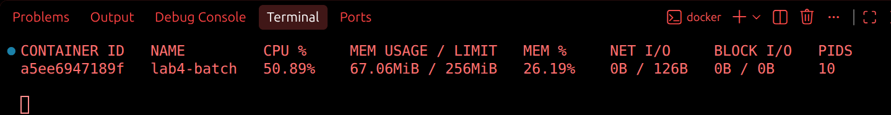

## Часть 1: Два стула

Итак, есть два стула, на одном podAntiAffinity, а на другом topologySpreadConstraints.
podAntiAffinity такой злой чел, негативный, соседей не любит: если у нас две реплики на двух нодах, то третью реплику он никуда не пустит, и она останется висеть в состоянии pending. Но в мягком режиме ему можно сказать "эээ братишка пусти переночевать по братски" - в таком случае планировщик старается разнести поды, но может разместить их и вместе
topologySpreadConstraints ровный пацанчик - старается поддерживать равномерность распределения подов. За базар отвечает, если сказано перекос между зонами не больше одного пода, значит все по красоте сделает - две реплики на одной ноде, одна на другой.

В качестве основного механизма решила выбрать topologySpreadConstraints, чтобы равномерно распределять поды. Файл values.yaml взят полностью из 3 лабы.

теперь в нем добавилось поле placement

api:
  replicas: 3
  placement:
    mode: topologySpreadConstraints
    topologySpreadConstraints:
      maxSkew: 1
      topologyKey: kubernetes.io/hostname
      whenUnsatisfiable: DoNotSchedule
      labelSelector:
        matchLabels:
          app.kubernetes.io/component: api

тут maxSkew - допустимая разница между нодами в количестве подов,
topologyKey: kubernetes.io/hostname - распределение между нодами,
whenUnsatisfiable: DoNotSchedule — под ждёт, если размещение нарушит правило,
labelSelector учитывает поды api

Можно было бы использовать и podAntiAffinity с мягким режимом, но я побоялась что если при необходимости он может распределять поды 2 к 1, то не исключена ситуация, что он разместит все 3 реплики на одной ноде, а такого нам не хотелось бы

На всякий случай проверяю что чарт собирается без ошибок:
helm lint "lab 4/chart"
результат:
1 chart(s) linted, 0 chart(s) failed
как проверить правильность настроек я хэ зэ, поэтому удалю нафиг это наверное.

## Часть 2: В тесноте и в обиде

Создам кластер с одной работающей нодой и одной управляющей. (см kind-config.yaml)

kind create cluster \
  --name lab4 \
  --config "lab 4/kind-config.yaml" \
  --wait 3m

(забавно что с первого раза ничего естественно не запустилось и ломалось на последнем этапе:
 ✗ Joining worker nodes 🚜 
Deleted nodes: ["lab4-worker" "lab4-control-plane"]
ERROR: failed to create cluster: failed to join node with kubeadm: command "docker exec --privilegedlab4-worker kubeadm join --config /kind/kubeadm.conf --v=6" failed with error: exit status 1
после того как я сделала буквально НИЧЕГО и попробовала еще раз, все заработало
Ну что за магия )
Проверяем как там наши ноды:
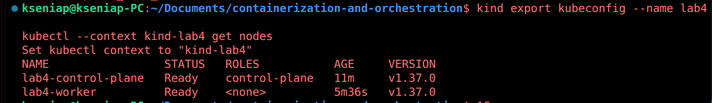

Ноды замечательно, а значит установлю оператор CloudNativePG, и добавлю его в наш кластер, потому что он же использовался и в 3 лабе.
helm repo add cnpg https://cloudnative-pg.github.io/charts
helm repo update cnpg
helm upgrade --install cnpg cnpg/cloudnative-pg \
  --kube-context kind-lab4 \
  --namespace cnpg-system \
  --create-namespace \
  --wait \
  --timeout 5m
После этого скачала Kyverno и настроила гвардрейлы, чтобы синхронизироваться с 3 лабой

(хаха гвардрейлы такое смешное слово, я читаю его каждый раз как Гвардиола, что говорит о том, что мне стоило меньше смотреть футбол этим летом)

Ладно, хиханьки да хаханьки закончились, поэтому собираю бразы api и worker, а затем загружаю их вместе с batch в кластер.
docker build \
  -f "lab 3/app/api.Dockerfile" \
  -t localhost:5001/shop-api:1.0.4 \
  "lab 3/app"
docker build \
  -f "lab 3/app/worker.Dockerfile" \
  -t localhost:5001/shop-worker:1.0.0 \
  "lab 3/app"
kind load docker-image \
  localhost:5001/shop-api:1.0.4 \
  localhost:5001/shop-worker:1.0.0 \
  localhost:5001/shop-batch:1.0.0 \
  --name lab4
В консоли после этого мне выводилось очень много букв, но как правило они означали успешный успех

После этого я добавила batch в Helm-чарт (см. values.yaml и templates/batch-deployment.yaml) и запустила чарт:
helm upgrade --install shop "lab 4/chart" \
  --kube-context kind-lab4 \
  --namespace default \
  --wait \
  --timeout 10m

Проверяю поды приложения shop - с ними все хорошо
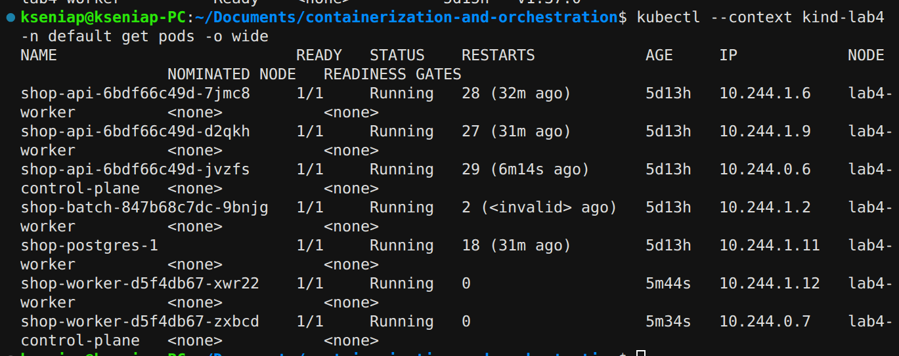

Главный вопрос - а для чего нужны были все эти телодвижения?
А сейчас мы с вами это и узнаем.

(а затем чтобы потом увеличивать нагрузку batch, создавая нехватку ресурсов.)

## Часть 3: Реальные пацаны

Суть всего этого замута, если я правильно поняла, в том что batch жрет ресурсы, обделяя своих товарищей. А мы такое терпеть не собираемся, а потом считаем циферки и понимаем сколько CPU и памяти действительно нужно магазину. И после насторойки кубера при нагрузке и нехватке ресурсов, первым ими жертвует именно batch, а не наш магазин.
Ну, погнали исполнять.

Первым делом подключаю мониторинг и скачиваю к6 (очередной непонятный покемон) - его просто подключаю в терминале, а потом имитирую действия клиента в js файле
тестовый прогон
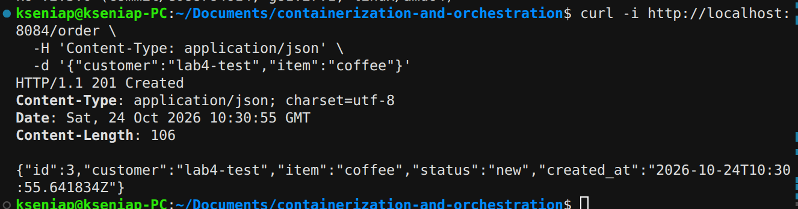

Но настоящий запрос лежит в файле k6-order.js. K6 же крут, потому что многократно повторяет запросы, описанные в js файле, показывает количество запросов, задержки и ошибки. В моем файле описаны Здесь два виртуальных клиента: каждый создаёт заказ, получает ответ и ждёт 0.2 секунды. Получится поток примерно до 10 заказов в секунду, продолжающийся пять минут. Звучит ужасно, посмотрим как взвоет мой сервис после такого.
Отдельно стоит отметить красоту терминала
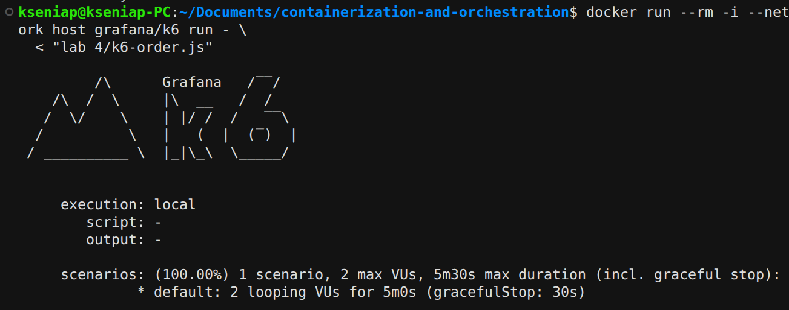
Итог работы - все работает, сервису ок
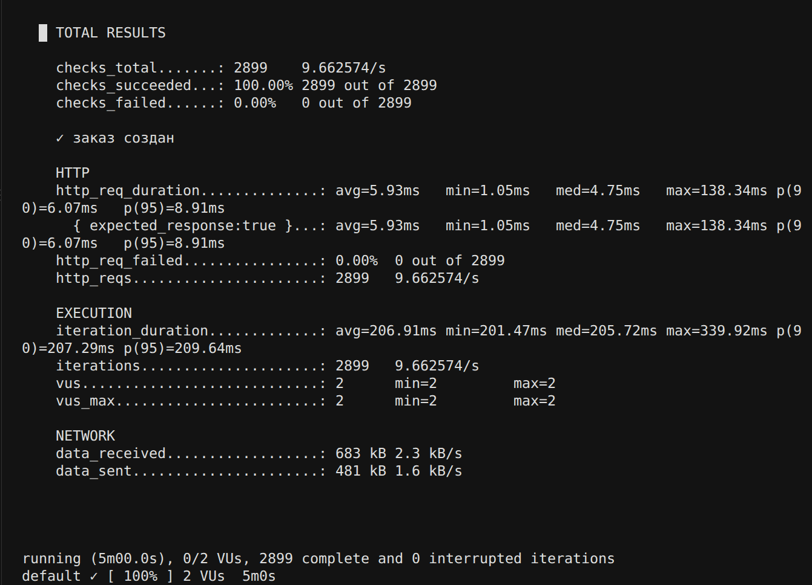
Заодно в Prometeus посмотрела как увеличивается CPU во время процесса (batch я исключила из рассмотрения, потому что там нагрузка постоянная)
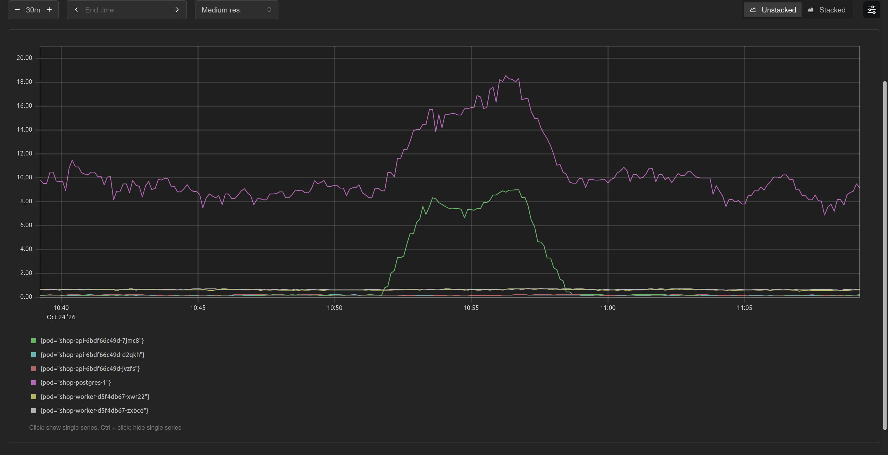
После нагрузки использую krr для определения максимальных параметров. CPU он считает как 95 перцентиль, память как максимум + 15%, а 10m и 100Mi — стандартные минимальные значения алгоритма.
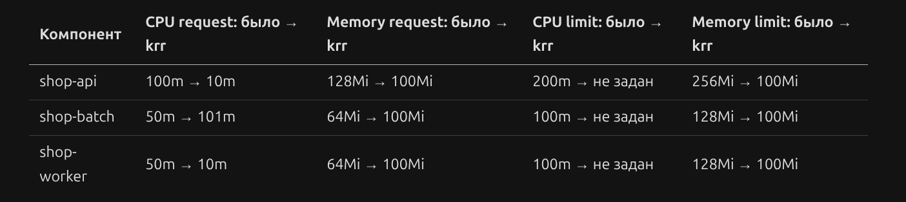
Вижу что реквесты CPU и память я задала сильно больше чем нужно. Лимиты CPU krr требует убрать, но как бы нононо мистер фиш, ю вонт ремув эти лимиты, наши гвардрейлы требуют их сохранить.

Оценку ресурсов для PostgreSQL я получала напрямую из Prometheus, получилось
CPU	15.773801
Память	184.040429
Это можно округлить до 16m и 185Mi

Осталось только задать эти значения в values.yaml и обновить через helm upgrade

## Часть 4: Полный разнос

Первое что я сделала на этом шаге - добавила выбор между topologySpreadConstraints и podAntiAffinity, потому что оказывается он должен был быть еще на первом шаге... После чего в api-deployment добавился такой кусок
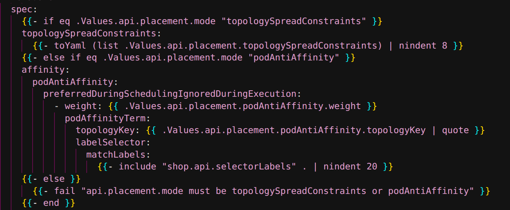
По умолчанию все равно стоит topologySpreadConstraints. После helm upgrade смотрю новое размещение api
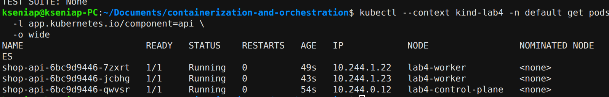
По сути ничего не изменилось - у нас и раньше ноды были размещены 2 + 1, просто сейчас мы закрепили это правило размещения в Deployment. Теперь мы точно уверены, что если одна нода упадет, то умрут не все реплики api.

## Часть 5: Вiйди отсюда розбiйник

Теперь будем расставлять PriorityClass для подов, чтобы шедулер понимал кто здесь батя, и кому достанется роскошная хата, а кому место у параши.
Api и postgres достается высокий приоритет, а batch - низкий. Теперь шедулер первым выселит с ноды поды с низким приоритетом, если понадобится разместить там поды с высоким.

Итак, в values завожу два класса и создаю шаблон PriorityClass. (тут ссылка на файл)
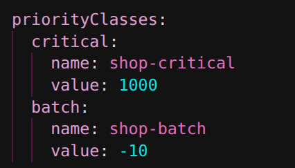
После helm upgrade смотрю на приоритеты подов - тут все как я и хотела.
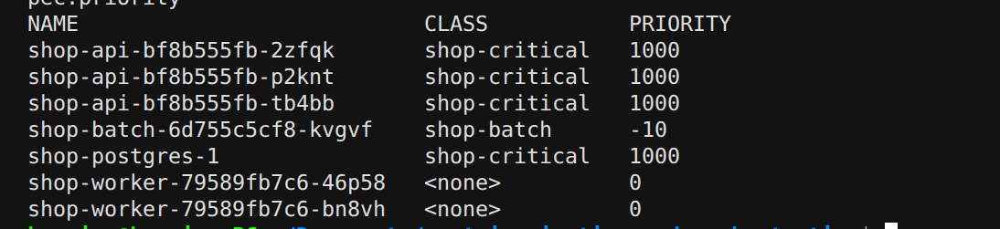
PDB — PodDisruptionBudget, правило, которое задаёт, сколько подов приложения должно оставаться доступными, например при обсуживании типа drain. Условно мы можем попросить на выход только один под, а остальные должны работать.
В моем случае я настроила шаблон api-pdb.yaml и прописала в values, что минимум который должен работать - 2 пода api 
  pdb:
    enabled: true
    minAvailable: 2
Для PostgreSQL Pdb настраивается отдельно, так как этот единственный под снимать нельзя.
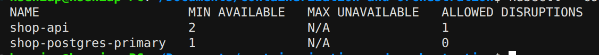

QoS (Quality of Service)— это класс, который Kubernetes автоматически присваивает поду по его requests и limits. Класс Guaranteed получается, когда requests равны limits и по CPU, и по памяти у всех контейнеров пода. Burstable это когда ресурсы заданы, но не равны, и еще есть BestEffort, когда вообще ничего не задано, и его кикают первым.

Я хочу получить Guaranteed для api и postgres, а значит надо задать лимиты равными реквестам, то есть по 10m у апи и 16m у базы.
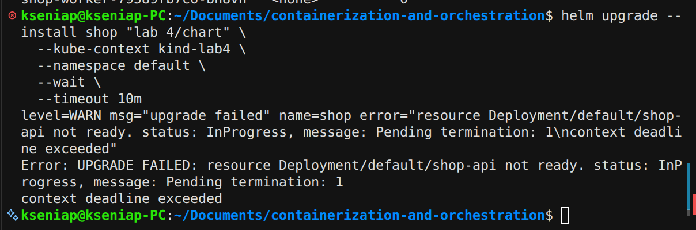
О, как же я ошибалась! Как же я ничего не понимала, страдала и плакала когда helm upgrade выдавал мне ошибку! Я очень долго с этим разбиралась, очень, за это время успели вырасти деревья, отстроиться города, а однокласники выйти замуж и родить детей... Как выяснилось, 10m это очень мало для жесткого лимита, из-за чего я все время ловила таймауты. 
Но даже так, в моем мозгу произошел коллапс - как же так, надо ставить разные реквесты и лимиты, чтобы следовать рекомендациям krr и при этом не ломаться, но при этом одинаковые, чтобы получить Guaranteed. Кто-нибудь помогите мне решить эту великую загадку человечества...

В общем видимо Guaranteed мне важнее чем рекомендации krr, поэтому для api и PostgreSQL я поставила CPU 200m везде. Получила свои заветные Guaranteed и геморой в жопе.
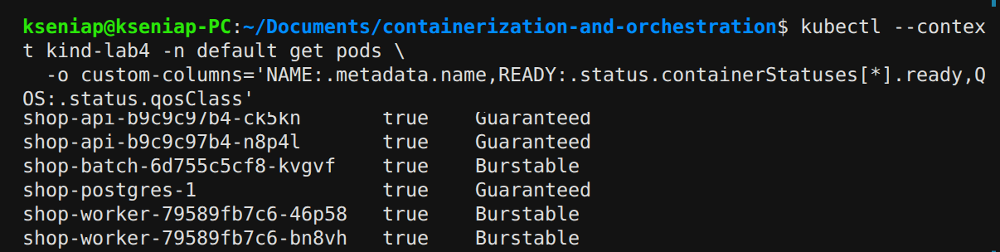