# Описание лабораторной работы №5
В этой лабораторной попробовал немного поэкспериментировать со стилем написания: сделать его не таким сухим, как было до этого, поэтому в тексте могут встречаться различные культурные отсылки. Приятного чтения!

# Шаг 0 - выбор Cilium или Calico
В начале работы над лабораторной работой нет полного понимания, что такое карта трафика. Хочу с ней поработать. Поэтому решил использовать Cilium. Помимо Hubble, Cilium работает на базе eBPF, который нужен для фильтрации трафика и позволяет задавать политики не только на конкретный ip/порт, но и на уровне приложения. 

# Шаг 1 - Разворачиваю shop к лесу задом, ко мне передом.
Развернул shop

Но избушка оказалась еще тем местом, в которое пробиться оказалось достаточно сложно... Чтобы заглянуть внутрь сети, пришлось воспользоваться временным отладочным контейнером. 

Внутри временного контейнера узнал iflink, он оказался 52, сразу ощущается питерский дух. В соседнем терминале нашел интерфейс veth с 52. Значит под соединен с нодой виртуальным кабелем. 

проверил пинг до постгреса

# Шаг 2 - Создаю хаос
Пока создавал хаос, сам стал хаосом... Было очень много времени потрачено на пересоздания всего и вся: то версия не та, то еще какая-то проблема. Но, все заработало, хаос был создан и прошел незаметно для сервиса
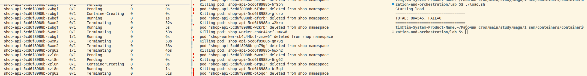

Разница между NodePort и LoadBalancer в том, что LoadBalancer - надстройка над NodePort, которая добавляет облачный балансировщик. А в headless вообще отсутствует общий адрес, а DNS отдает адреса всех подов сразу. 

Хаос прошел незаметно по нескольким причинам:
- Service предоставляет стабильный виртуальный ip адрес и порт, которые не меняются, даже когда умирает под. 
- Controller Manager следит за тем, чтобы когда под убит, то его ip адрес удаляется. А когда под создается и проходит readiness probe, его ip добавляется обратно.
- Cilium постоянно читает EndpointSlice и обновляет правила маршрутизации. 

Я заменил kube-proxy на Cilium с `kubeProxyReplacement=true`. Разница между `iptables` и `IPVS` в том, что в IPVS используется хеш-таблица, которая делает поиск за O(1), в то время как iptables делает ту же операцию за O(N). Это становится заметно только при большом числе Service'ов. eBPF же также использует хеш-таблицы, но на уровне ядра, что еще больше ускоряет процесс относительно IPVS.

# Шаг 3 - Матрица доступа

| Источник | Назначение | Порт / Протокол | Разрешено? | Обоснование |
| :--- | :--- | :--- | :--- | :--- |
| Внешний клиент (через NodePort) | Поды `api` | 8080/TCP | да | Пользователи должны иметь возможность отправлять заказы и проверять статус. |
| Поды `api` | Поды PostgreSQL (CNPG) | 5432/TCP | да | `api` должен читать и записывать заказы в базу данных. |
| Поды `worker` | Поды PostgreSQL (CNPG) | 5432/TCP | да| `worker` читает новые заказы и обновляет их статус на `processed`. |
| Поды `api`, `worker`, `postgres` | CoreDNS (`kube-system`) | 53/UDP | да | Без этого поды не смогут резолвить имена. |
| Любой под (например, `debug`) | Поды PostgreSQL (CNPG) | 5432/TCP | нет | Посторонние сервисы не должны иметь доступ к базе данных. |
| Поды `shop` | Внешний интернет | Любой | нет | Приложению не нужен доступ в интернет для работы. |
| Любой под из других namespace | Поды `api` или `worker` | Любой | нет | Только клиент через NodePort может обращаться к api. |

# Шаг 4 - egress и ingress - части одного целого.
Все заработало, но не с первого раза. Сначала была проблема с подключением api к postgres. Оказалось, что egress и ingress должны дополнять друг друга, и если одного нет, то и другое работать не будет, потому что default-deny блокировал все входящее. 
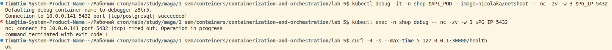

# Шаг 5 - я тестировщик
Внешний клиент обращается к api - успех
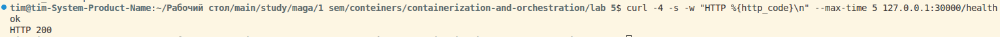

от непонятного пода (debug) к postgres - отказ
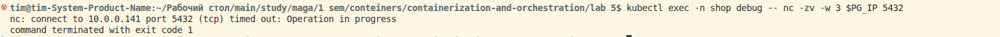

от api к postgres - успех
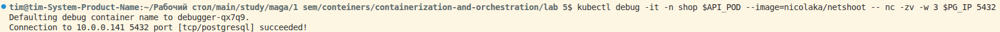

от worker к postgres - успех
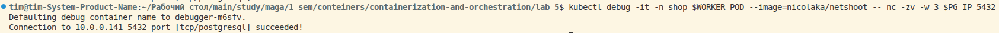

от debug к dns - успех
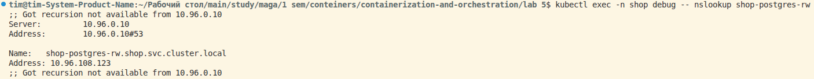

от debug в интернет - отказ
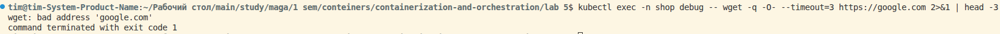

worker обрабатывает заказ - успех
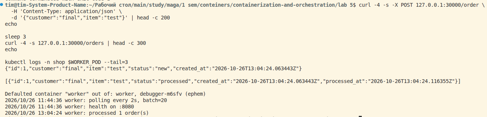

| # | Источник | Назначение | Порт | Ожидаемо | Фактически | Команда проверки | Ожидаемо == Фактически ? |
|---|---|---|---|---|---|---|---|
| 1 | Внешний клиент | `api` | 8080 | да | 200 OK | `curl 127.0.0.1:30000/health` | ✅ |
| 2 | Под `debug` | `postgres` | 5432 | нет | timed out | `kubectl exec debug -- nc -zv $PG_IP 5432` | ✅ |
| 3 | Под `api` | `postgres` | 5432 | да | succeeded! | `kubectl debug api -- nc -zv $PG_IP 5432` | ✅ |
| 4 | Под `worker` | `postgres` | 5432 | да | succeeded! | `kubectl debug worker -- nc -zv $PG_IP 5432` | ✅ |
| 5 | Под `debug` | DNS (CoreDNS) | 53 | да | IP получен | `kubectl exec debug -- nslookup shop-postgres-rw` | ✅ |
| 6 | Под `debug` | Внешний интернет | 443 | нет | timeout | `kubectl exec debug -- wget https://google.com` | ✅ |
| 7 | Под `worker` | `postgres` (бизнес-логика) | 5432 | да | order processed | `kubectl logs worker` → "processed 1 order(s)" | ✅ |

# Шаг 6 - я не Трелони
Поменял номер порта с 8080 на 9999, попробовал установить соединение, но оно заблокировалось из-за того, что разрешен только 9999, а под слушает 8080
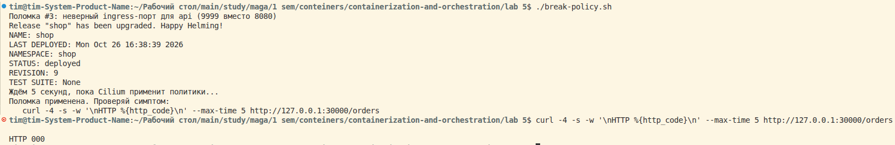

Чтобы не гадать, как некоторые горе-прорицательницы, открыл Hubble. На карте видно, что красная линия идет на порт 8080 от внешних источников: клиента и прометеуса, а снизу в таблице написано dropped у обращения к порту 8080. 
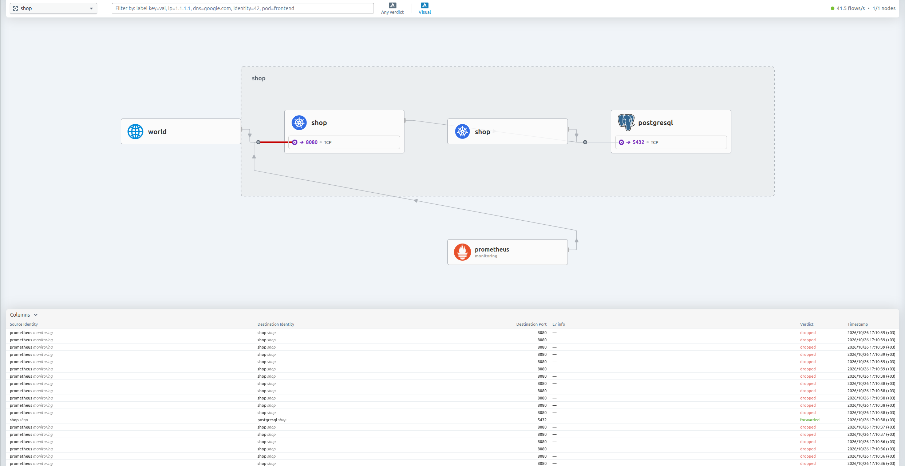

Починил соединение. Флаг --reset-values гарантированно сбрасывает поломку 
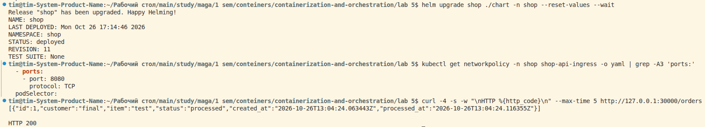
В Hubble тоже все зеленое
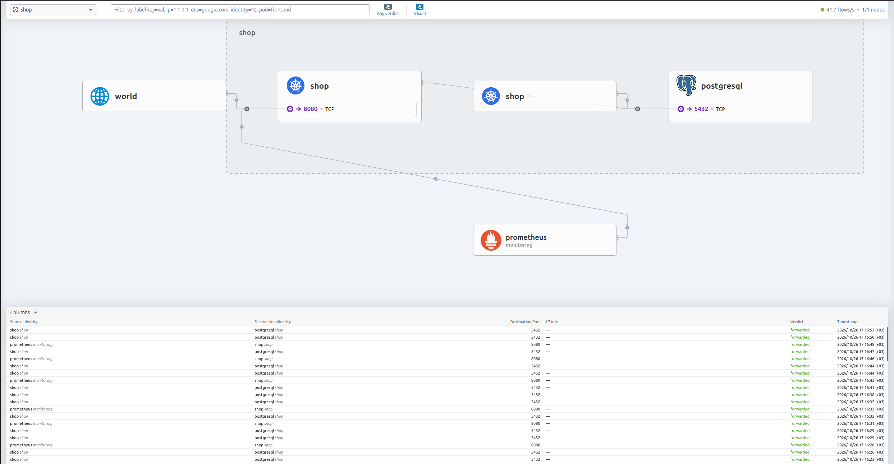

# Шаг 7 - Слежу
Cilium таргет поднялся и в статусе Up
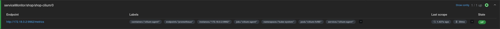

Обоснование алертов:
- CiliumPolicyDrops показывает, как сетевая политика блокирует трафик. Если мы добавили новую версию и трафик упал, то алерт сразу укажет на эту проблему. Порог 5 пакетов в секунду в течение 1 минуты защищает от одиночных случаев, но ловит массовые блокировки.
- CiliumDNSFailures показывает, как поды резолвят имена. Если поды перестают их резолвить, то сервис падает. Алерт ловит массовые ошибки.
- CiliumAgentDown - критический алерт. Если прометеус не может собрать метрики, значит упал сетевой стек, что приводит к большим проблемам.

Для проверки CiliumPolicyDrops сгенерировал трафик с пода debug на postgres (запрещено кому-то ходить в бд, кроме api и worker). Через минуту алерт перешел в статус FIRING.
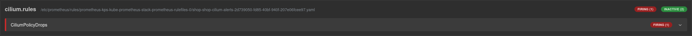