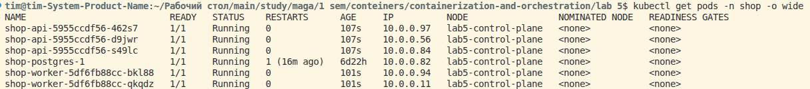
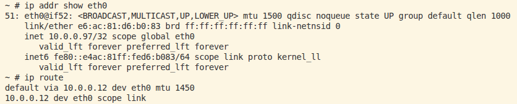
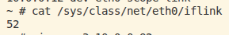
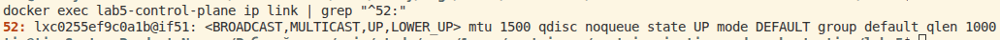
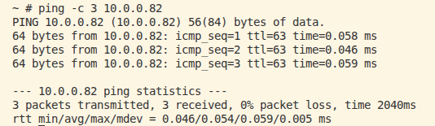

# Описание лабораторной работы №5
!!! заполнить в конце, когда будет полное понимание !!!

# Шаг 0 - выбор Cilium или Calico
На начало работы над лабораторной работой нет полного понимания, что такое карта трафика. Хочу с ней поработать. Поэтому решил использовать Cilium. Помимо Hubble, Cilium на базе eBPF, который нужен для фильтрации трафика и позволяет задавать политики не только на конкретный ip/порт, но и на уровне приложения. 

# Шаг 1 - Разворачиваю shop к лесу задом, ко мне передом.
Развернул shop

Но избушка оказалась еще тем убежищем, в которое пробиться оказалось достаточно сложно... Чтобы заглянуть внутрь сети пришлось воспользоваться временным отладочным контейнером. 

Внутри временного контейнера узнал iflink, он оказался 52, сразу ощущается Питерский дух. В соседнем терминале нашел интерфейс veth с 52. Значит под соединен с нодой виртуальным кабелем. 

проверил пинг на постгрес
