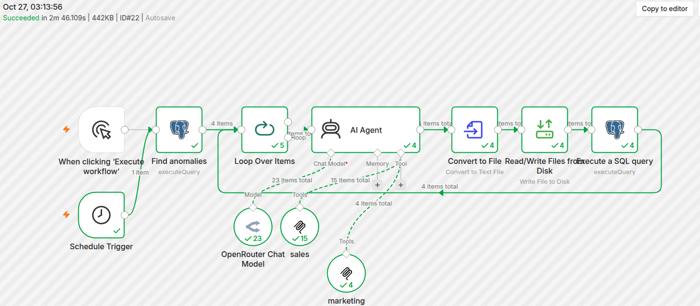
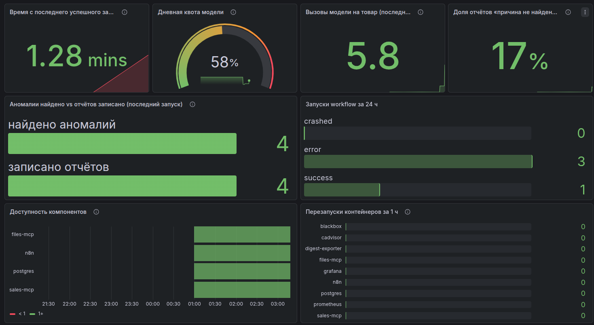
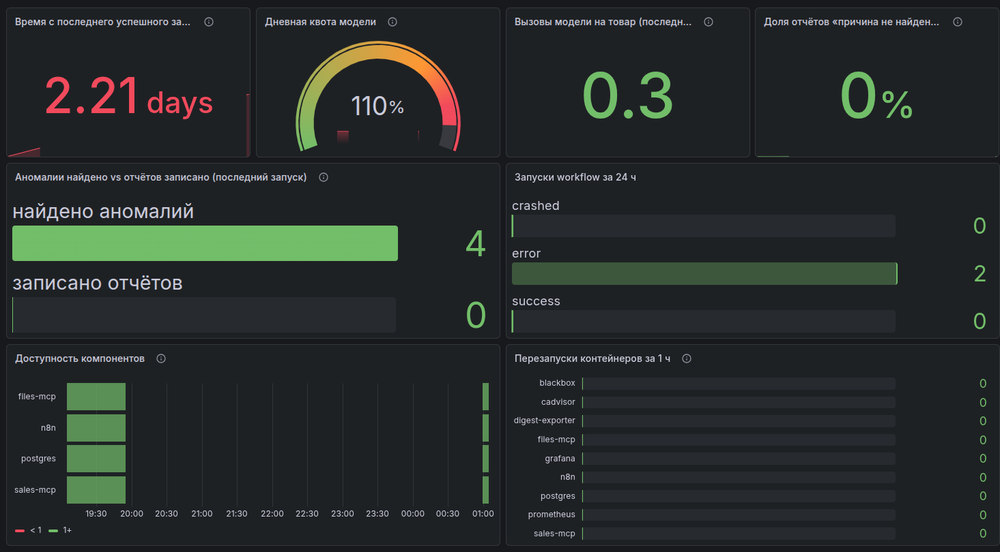
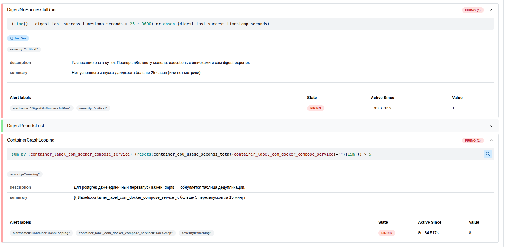

# Лаба 7 — Автоматизация devops-процесса с n8n + AI

**Более короткую версию README можно найти непосредственно в папке furniture-demand-digest. Там все требования из пункта - что сдать. Тут подробный развернутый отчет**

## Часть 1 — Кейс

В своей лабораторной я решила придумать мебельный магазин среднего размера (примерно 150 человек работников по всей сети в разных городах). Продают мебель от разных производителей, ничего не производят. В штате есть продавцы, аналитики, программисты, грузчики.

Какие системы в компании реализованы:
- БД
- сайт для покупки
- сервис прогнозирования спроса на товары

Сервис, который я реализовала, поможет аналитикам данных анализировать и выявлять причины аномального роста спроса на товар (>1.5 раз). Решает проблему ручного поиска в чем причина такого роста спроса, ведь их может быть множество - оптовые закупки, реклама, новинки. Даже просто то, что какой-то общительный сосед купил новый диван. Проблема составления вручную таких отчетов банальна - данные хоть и структурированы, но лежат в разных местах. Нужно время, чтобы просмотреть заказы, историю цен, карточку товара и маркетинговый календарь. Так нужно будет просмотреть каждый товар, а у магазина могут быть тысячи разных товаров в разных городах. Ну и банально автоматизация поиска причин освобождает аналитикам время для продумывания чего-то более масштабного - подготовка данных к праздникам, расширение ЦА, расширение сети в другие города.

**Что именно делает автоматизация**

Спрос на товар за неделю вырос больше чем в 1.5 раза -> ии агент анализирует возможные причины -> сформированный ии отчет сохраняется в папку reports/ файлом с названием в виде даты отчета и артикулом в названии.
Ии агент не меняет никакие данные и ничего не переделывает, просто формирует отчет с основными причинами такого роста.

## Часть 2 — Что должно быть в реализации

**Как определяется аномалия**

1. минимальный порог объема продаж. Для каждого товара есть свой минимальный порог продаж за неделю, ниже которого рост не считается аномалией. Пример: была 1 продажа на прошлой неделе, стало 3. В цифрах рост колоссальный, по факту - бесполезная проверка. Для каждого товара выставляется свой порог, который прописывается в БД;
2. товары младше недели. Поскольку для них нельзя посчитать недельный рост, заводится прогнозируемое число продаж, и уже с ним сравнивается фактический результат;
3. дедупликация неделя. Если отчет был отправлен аналитику по товару, то этот товар неделю не будет встречаться в отчетах, чтобы бесполезно не спамить. Отметка об отчете ставится в n8n уже после сохранения отчета, чтобы, в случае потери/падения записи отчета, товар попадет в подборку на следующий день.

Каждый день в 9 утра запускается проверка - это Schedule Trigger. Плюс существует Manual Trigger для ручного запуска.

Нода пересчитывает продажи каждого товара за текущую и прошедшую недели. (не ии) -> если виден аномальный рост запускается агент (не ии) -> агент анализирует причины роста спроса (ии агент) -> формируется отчет на основе результата работы (ии агент) -> отчет сохраняется в папку reports/ (не ии) -> отметка в reported_anomalies (не ии).

**2 MCP сервиса:**

 - sales-mcp - сервер на питоне, который ходит в postgres для получения данных о заказах, ценах, карточках товаров и продаж по городам с помощью mcp_reader. Имеет право отправлять только запрос SELECT, чтобы избежать проблем с БД из-за глупого ии агента.
 - files-mcp - готовый filesystem MCP, маркетинговый календарь смонтирован :ro. Агенту в n8n оставлен только read_text_file. 
    
**toolkit агента**

 - get_large_orders (sales-mcp) - находит крупные заказы товара (опт). На вход подается: sku — артикул (обязательно), days — за сколько дней (по умолчанию 7), min_qty — от скольких штук в заказе считать его крупным, по умолчанию >= 3;
 - get_price_history (sales-mcp) - возвращает историю цены (проверка скидок). На вход: sku — артикул (обязательно), days — за сколько последних дней смотреть историю цен (по умолчанию 30);
 - get_product_info (sales-mcp) - все данные о товаре, в том числе дата его появления в каталоге (проверка на новинку). На вход: sku — артикул (обязательно);
 - get_sales_by_city (sales-mcp) - продажи товара по городам, где конкретно был спрос (проверка на рекламу). На вход: sku — артикул (обязательно), days — длина периода сравнения: последние N дней против N дней до этого (по умолчанию 7);
 - read_text_file (files-mcp) - читает маркетинговый календарь (для проверки гипотезы реклама). На вход:  path — путь к файлу (обязательно), в лабораторной - /data/marketing/campaigns.md.

**Описанные skills**

Все красиво описано в файле skills/demand-spike-investigation.md. 

Краткие тезисы из файла:
- порядок проверки гипотез: опт -> скидка -> новинка -> реклама -> причина не найдена.
- две независимые оценки для модели - сила причины роста спроса (рост из-за оптовой закупки = сильная причина), доля прироста (какую часть прироста можно объяснить этой причиной). Доля существует только для объяснения опта и рекламы. 
- модель останавливается в двух случаях - если причина сильная и % обоснования >60% ИЛИ если причина средняя и % обоснования >=80%.
- не больше 5 вызовов инструментов (по 1 вызову на каждый инструмент).
- если ни одна гипотеза не подтвердилась модель ничего не выдумывает, пишет что причина не найдена.
- отчет на русском языке.

В результате работы агента ожидается готовый отчет в формате .md.

## Часть 3 — Запуск локально

Для работы с этой лабораторной я создала API ключ в OpenRouter. Использовала бесплатную модель nvidia/nemotron-3.5-lightning:free. Сначала была другая модель, но она работала нестабильно, и была заменена на текущую. Первые отчеты (за 24) были сделаны с помощью другой модели, поэтому могут быть небольшие расхождения в структуре и стиле отчетов.

Всё работает в одном docker-compose.yml.
Что потребовалось для решения лабораторной:

| Компонент | Что это | Зачем |
|---|---|---|
| n8n 2.43.8 | движок workflow | ядро процесса |
| Postgres | моковая БД магазина: товары, заказы, цены, прогнозы | вместо настоящей БД |
| sales-mcp | свой MCP-сервер на Python | 4 инструмента к БД |
| files-mcp | готовый filesystem MCP | чтение маркетингового календаря |
| mock-marketing | одноразовый скрипт | генерирует календарь событий |
| Prometheus, Grafana и др. | мониторинг | Часть 4 |

Навайбкодила следующие штуки (проверяла, все рабочее):
- `postgres/init/01_schema.sql`, `02_seed.sql` — мок-БД, даты от CURRENT_DATE; сценарии под каждую гипотезу + шум + «причина не найдена» + новинка младше недели.
- `postgres/init/03_roles.sh` — пользователи `mcp_reader` (только SELECT) и `n8n_app` (SELECT + INSERT в дедупликацию).
- `sales-mcp/server.py` — инструменты `get_product_info`, `get_large_orders`, `get_price_history`, `get_sales_by_city`.
- `mock/generate_marketing.py` — маркетинговый календарь с датами от сегодня.
- `digest-exporter/exporter.py` — экспортер метрик процесса для Prometheus: опрашивает API n8n и папку `reports/`, отдаёт время последнего успеха, найдено/записано, вызовы модели и расход квоты (подробнее — в части 4).

Далее сама (с подсказками ии) собрала систему в n8n. 

**Во время тестирования работоспособности системы возникали следующие ошибки:**

- изначально был выставлен слишком большой лимит (15 обращений для 1 позиции). Дневной лимит обращений к бесплатным моделям в день 50 раз. У меня отвалилась система из-за превышения запросов к бесплатной модели, потому что модель зациклилась, n8n не дошла до написания отчета, потому что все товары крутились в агенте одновременно, и данные просто исчезли, не дойдя до записи. Исправила так - поменяла макс кол-во шагов до 8 (5 - обращение к инструментам, 1 - составление отчета, 2 - прозапас), поставила loop, где за один прогон через агента проходит ровно по 1 товару. Также в skill прописала последовательность - только вперёд, каждый инструмент не больше раза использовать.
- отчет после успешной отработки ии-агента не был сохранен. Причина - система пыталась по цепочке восстановить артикул товара и натыкалась на несоответствие (почему-то он думал что выходит из 0 выхода из loop, хотя выходил из 1). В итоге он не смог найти как назваться и просто потерял данные. Для решения проблемы система теперь берет артикул по номеру прохода цикла.
- самая главная и идиотская проблема, которая почему-то возникла только сейчас. Я перезапустила комп, включила ускоритель интернета, и он просто отказался работать. Соединение есть, пакеты не уходят. 3 часа страданий и ковыряний в терминале привели меня к прозрению - docker и ускоритель делят один сетевой порт, и если docker встал на него первым, то он не пускает ускоритель. А ускоритель добрее, он, если встраивается первый, пускает docker донастроить своего на порт. Я до конца не уверена в причине проблемы, но как я поняла, суть в том, что  docker при старте переписывает правила iptables. Очень необычно и мило, я потратила кучу нервов и сил на решение этой проблемы. Стала умнее и опытнее. 

**Результат первого успешного запуска**



Скриншот показывает, что все ноды выполнились успешно за 2 мин 46 с. Find anomalies нашёл 4 аномалии, Loop Over Items передал их агенту по одному, по каждой записан отчёт и поставлена отметка в `reported_anomalies`. Модель вызвана 23 раза (5,75 на товар при лимите 8), инструменты — 19 раз: 15 через `sales` (sales-mcp) и 4 через `marketing` (files-mcp).

**Результаты по всем тестовым сценариям**

| Отчёт | Что заложено в мок-данных | Вывод агента |
|---|---|---|
| [`reports/2026-10-24_SOFA-OSLO.md`](furniture-demand-digest/reports/2026-10-24_SOFA-OSLO.md) | оптовый заказ кофейни на 12 шт. | ✅ опт, доля роста 100% |
| [`reports/2026-10-24_BED-ARIA.md`](furniture-demand-digest/reports/2026-10-24_BED-ARIA.md) | билборд в Казани, рост там же | ✅ реклама |
| [`reports/2026-10-27_CHAIR-NORD.md`](furniture-demand-digest/reports/2026-10-27_CHAIR-NORD.md) | акция −30% | ✅ скидка |
| [`reports/2026-10-27_TABLE-LUNA.md`](furniture-demand-digest/reports/2026-10-27_TABLE-LUNA.md) | товару 18 дней | ✅ новинка |
| [`reports/2026-10-27_SHELF-KUBO.md`](furniture-demand-digest/reports/2026-10-27_SHELF-KUBO.md) | товару 3 дня, сравнение с прогнозом | ✅ новинка младше недели |
| [`reports/2026-10-27_WARDROBE-ALBA.md`](furniture-demand-digest/reports/2026-10-27_WARDROBE-ALBA.md) | причины нет | ✅ «причина не найдена» |
| — (STOOL-MINI) | рост 2 → 4 шт., ниже порога объёма | ✅ отсечён SQL, отчёта нет |

После повторного прогона SQL возвратил 0 товаров - дедупликация работает.

**Пример отчета**

```
# Рост спроса: Стул Норд (CHAIR-NORD)

**Коротко:** Продажи выросли с 21 до 45 штук (более чем в 2 раза). Основная подтверждённая причина — акция «Осенняя распродажа −30%», начавшаяся 21 октября и действующая на текущую неделю. Другие причины (опт, новинка, реклама) не нашли подтверждения в данных.

## Цифры
- Прошлая неделя: **21** шт. → текущая: **45** шт. (× 2,14, + 24 шт.)  
- Прогноз сервиса: **22** шт.

## Проверенные гипотезы
| # | Гипотеза | Результат | Сила | Доля роста | Доказательство |
|---|---|---|---|---|---|
| 1 | Оптовая закупка | **не подтверждена** | — | — | `sales_get_large_orders` вернул 0 заказов компаний/крупных заказов |
| 2 | Скидка | **подтверждена** | средняя | **не измерима** | Акция «Осенняя распродажа −30%» с **21 октября 2026 по настоящее время**, скидка 30,1 % (история цен) |
| 3 | Новинка | **не подтверждена** | — | — | Возраст товара **300 дней** (более 45 дней), `younger_than_week = false` |
| 4 | Реклама | **не подтверждена** | — | — | В маркетинговом календаре кампаний по SKU **CHAIR‑NORD** не найдено; рост распределён по городам, но нет привязки к рекламе |

## Вывод
- Единственная подтверждённая причина роста — **скидка в рамках акции «Осенняя распродажа −30%»** (актуальна на текущую неделю).  
- Сила доказательства — **средняя**, доля роста **не измерима** (по правилам нельзя выделить процент прироста, объясняемый скидкой).  
- Условие остановки (сильная сила + доля > 60 % или средняя + доля ≥ 80 %) **не выполнено**, проверка продолжалась по всем hipótesis.  
- Уверенность в выводе: **средняя** (одна причина подтверждена, но доля не посчитана).

```
*Другие отчеты* можно посмотреть в папке [furniture-demand-digest/reports/](furniture-demand-digest/reports/).

## Часть 4 — Мониторинг

**Стек мониторинга**
- Prometheus - собирает метрики раз в 15 секунд и проверяет условия алертов
- digest-exporter - на вайбе написанный экспортер. Нужен потому что n8n отдает только технические метрики. Данные берутся из API n8n и папки reports/
- blackbox-exporter - проверяет доступность сервисов снаружи. HTTP-запрос к n8n, TCP-подключение к MCP и Postgres. Контейнер может быть запущен, но не отвечать
- cAdvisor - метрики контейнеров, их перезапуски
- Grafana - дашборд, подключается автоматически из файлов provisioning

**Какие метрики видны на дашборде**

Я решила, что самые важные метрики такие:
- время с последнего успешного запуска - показывает, когда система в принципе запускалась в последний раз. Норма - раз в 24 часа
- дневная квота модели - сколько запросов от общего количества потрачено сегодня. Недостаток - метрика считает только обращения агента к моделям. Метрика не отображает обращения к моделям вне n8n
- вызовы модели на товар - проверяет, не зациклилась ли модель. Норма - 6 обращений на товар. Если выше, надо разбираться
- доля отчетов "причина не найдена" - показывает процент неустановленных причин. Если процент слишком высокий - агент некорректно отрабатывает
- аномалий найдено vs отчётов записано (последний запуск) - если значения отличаются, часть отчетов потеряна
- запуски workflow за 24 ч - сколько было всего попыток запуска агента за сутки и сколько из них упало и статус ошибки
- доступность компонентов - зеленая если компонент работает и отвечает. Доступность проверяется снаружи системы
- перезапуски контейнеров за 1 ч - считается по обнулению счётчика CPU. Время старта контейнера тут не подходит - при restart оно не меняется

На скриншоте дашборд сразу после успешного запуска workflow.



На скриншоте дашборд, на котором видно сразу несколько проблем - последний раз система запускалась больше суток назад и количество отчетов не совпадает с найденными аномалиями. А также workflow оба раза отработал с ошибкой:) В общем, система работает, но процесс полностью поломался.



**3 главных алерта**

Алерты стоят на симптомы, а не на причины:

1. DigestNoSuccessfulRun(critical) - срабатывает, если последний запуск был >25 часов назад или метрика "время с последнего успешного запуска" не доступна дольше 5 минут. Если сам экспортер упадёт, метрики не будет, и без этого условия алерт бы молчал. Ловит любую поломку системы - n8n лег, кончилась квота, расписание выключили и тд.  Почему 25, а не 24 часа - запуск раз в сутки, час на задержку. 
2. DigestReportsLost (warning) - срабатывает, сразу после неудачного запуска workflow. И ловит потери отчетов по аномалиям. Почему он нужен - дополнение к пункту 1. Быстро ловит частичные потери данных.
3. ContainerCrashLooping (warning) - какой-либо сервис перезапускается больше 5 раз за 15 минут. Нужен чтобы отлавливать постоянно падающие контейнеры. Порог 5 потому что быстрые перезапуски могут потеряться при опросе  Prometheus раз в 15 секунд. 

**Куда сохраняются метрики**

Docker volume prom_data (в compose: prom_data:/prometheus). Формат — TSDB. Хранится по умолчанию 15 дней. Volume - чтобы случайно не пропали данные при выключении/перезапуске системы.

**Показываю Prometheus и работоспособность алертов**

На скриншоте показана ситуация, при которой остановился digest-exporter. Prometheus перестал получать метрики процесса, а sales-mcp постоянно перезапускался. Ситуация была смоделирована специально чтобы продемонстрировать корректную работу алертов. Экспортер был остановлен вручную, а контейнер перезапускался в цикле.



DigestReportsLost остался зелёным, и это правильно: без экспортера ему нечего сравнивать. 

